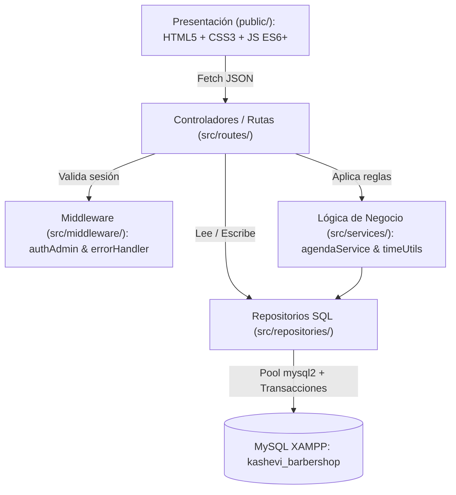

# 💈 KASHEVI BARBERSHOP — Documentación General del Proyecto

Plataforma web integral que combina la identidad visual de **Kashevi Barbershop** (*One-Page* editorial) con un **sistema transaccional de reservas en tiempo real**, **confirmación automática por WhatsApp** y un **panel administrativo protegido** para la gestión operativa del estudio.

---

## 1. Tecnologías Utilizadas

| Capa | Tecnología / Librería | Propósito en el proyecto |
|---|---|---|
| **Frontend** | **HTML5 semántico** | Estructura accesible de la web pública (`index.html`) y panel admin (`admin.html`). |
| | **CSS3 modular** | Variables de diseño (`tokens.css`), Grid, Flexbox, `clip-path` diagonal, máscaras orgánicas y diseño adaptable (*responsive*). |
| | **JavaScript ES6+ puro (Vanilla JS)** | Módulos nativos (`type="module"`), consumo REST con `Fetch API`, validación en vivo, carrusel y modales sin frameworks pesados. |
| **Backend** | **Node.js + Express (`^4.21.2`)** | Servidor HTTP para archivos estáticos y API REST (`/api/*` y `/api/admin/*`). |
| | **`mysql2` (`^3.11.5`, Promise Pool)** | Conexión asíncrona con *pool* hacia MySQL de XAMPP, consultas parametrizadas y soporte de transacciones. |
| | **`dotenv` (`^16.4.7`)** | Carga centralizada de configuración sensible y del negocio desde `.env`. |
| **Seguridad** | **`bcryptjs` (`^2.4.3`)** | Hash seguro de contraseñas de administradores (`usuarios_admin`). |
| | **`node:crypto` (HMAC-SHA256)** | Emisión y verificación de tokens firmados para proteger las rutas `/api/admin/*`. |
| **Base de Datos** | **MySQL / MariaDB (XAMPP)** | Almacenamiento relacional (`kashevi_barbershop`) con motor transaccional `InnoDB` y claves foráneas. |
| **Calidad** | **`node:test` + `node:assert`** | Pruebas unitarias nativas sobre reglas de negocio (horarios, traslapes, capacidad y validaciones). |

---

## 2. ¿Qué Problemas Resuelve Este Sistema?

1. **Elimina el doble agendamiento y cruces de horario:**
   * Valida disponibilidad real en servidor dentro de una transacción MySQL (`BEGIN ... FOR UPDATE ... COMMIT`) antes de confirmar cualquier turno.
2. **Gestiona correctamente la capacidad real de 4 barberos:**
   * Permite hasta 4 atenciones simultáneas (una por talento disponible), asigna automáticamente al barbero libre con menor carga del día o respeta el barbero elegido por el cliente.
3. **Controla duraciones distintas y la hora de cierre:**
   * No muestra turnos que superen las `22:00` (por ejemplo, un servicio de `60 min` no se ofrece a las `21:30`), oculta horas pasadas del mismo día y bloquea domingos automáticamente.
4. **Automatiza la confirmación por WhatsApp:**
   * Genera un código único de reserva (`KSH-YYYYMMDD-XXXX`) y abre WhatsApp con el mensaje prellenado hacia el número del negocio (`+51 907 550 557`).
5. **Separa la operación diaria del histórico:**
   * El panel administrativo ofrece una vista de **Citas Generales** (todo el histórico y filtros) y otra de **Citas de Hoy** (agenda cronológica del día).
6. **Evita tocar código o base de datos para cambios cotidianos:**
   * Desde `/admin.html` el dueño puede cambiar precios, duraciones, activar/desactivar barberos, aprobar testimonios o bloquear horarios manuales (refrigerios, feriados) y todo se refleja al instante en la web pública.

---

## 3. Arquitectura del Sistema

El proyecto aplica una **Arquitectura en Capas** con separación clara de responsabilidades:



### ¿Cómo fluye una petición de reserva?
1. **Presentación (`public/js/agenda.js`):** Cuando el usuario elige servicio y fecha, consulta `GET /api/disponibilidad` y habilita solo horas reales libres.
2. **Ruta (`src/routes/publicRoutes.js`):** Valida formato de fecha, teléfono, nombre y existencia de servicio/barbero.
3. **Transacción + Negocio (`src/services/agendaService.js` + `src/repositories/`):** Inicia transacción en MySQL, bloquea filas activas del día (`FOR UPDATE`), verifica traslapes contra citas y `bloqueos_horario`, selecciona el barbero libre y genera el código de reserva.
4. **Respuesta:** Guarda la cita en `citas`, cierra la transacción (`COMMIT`) y devuelve los datos junto con el enlace `https://wa.me/...`.

---

## 4. Organización Lógica de Carpetas y Archivos

```text
KASHEVI_BARBERSHOP/
├── public/                        # Capa de Presentación (archivos públicos servidos por Express)
│   ├── index.html                 # Landing One-Page pública y formulario de reservas (#agenda)
│   ├── admin.html                 # Panel administrativo con login y 6 pestañas de gestión
│   ├── css/
│   │   ├── tokens.css             # Paleta corporativa (#000000 / #F0E8A1), tipografía y radios
│   │   ├── styles.css             # Estilos de la web pública, modales, carrusel y responsive
│   │   └── admin.css              # Estilos del login, KPIs, tablas, pestañas y formularios admin
│   ├── js/
│   │   ├── api.js                 # Cliente Fetch centralizado y manejo uniforme de errores HTTP
│   │   ├── main.js                # Navegación móvil, catálogo dinámico, modal + DETALLES y carrusel
│   │   ├── agenda.js              # Lógica de fechas, horarios disponibles y redirección a WhatsApp
│   │   └── admin.js               # Autenticación admin, vistas Citas Generales/Hoy y CRUD administrativo
│   └── img/                       # Fotografías de hero, nosotros, servicios, ritual y testimonios
│
├── src/                           # Backend estructurado por capas
│   ├── config/
│   │   ├── env.js                 # Variables de entorno (.env) y constantes de horario (09:00–22:00)
│   │   └── db.js                  # Pool mysql2/promise (dateStrings: true) y helper withTransaction()
│   ├── middleware/
│   │   ├── authAdmin.js           # Firma y verificación HMAC-SHA256 para proteger /api/admin/*
│   │   └── errorHandler.js        # Clase AppError, asyncHandler y respuestas JSON uniformes
│   ├── services/
│   │   ├── timeUtils.js           # Cálculos puros de fechas/horas sin desfases UTC y traslapes
│   │   └── agendaService.js       # Motor de disponibilidad, balanceo entre barberos y URL WhatsApp
│   ├── repositories/
│   │   ├── catalogoRepository.js  # Consultas SQL de servicios, barberos y testimonios
│   │   ├── citasRepository.js     # Ocupación del día, inserción atómica y CRUD de citas
│   │   ├── bloqueosRepository.js  # Consultas, creación y eliminación de bloqueos horarios
│   │   └── adminRepository.js     # Lectura, creación y cambio de clave de administradores
│   └── routes/
│       ├── publicRoutes.js        # Endpoints públicos (/health, /config, /servicios, /disponibilidad, /citas)
│       └── adminRoutes.js         # Endpoints protegidos (/login, /citas, /bloqueos, /servicios, /barberos, /testimonios, /usuarios)
│
├── sql/
│   └── kashevi_db.sql             # Script DDL + datos semilla (importable en phpMyAdmin de XAMPP)
├── scripts/
│   └── setup-db.js                # Script CLI para crear BD, tablas y usuario admin inicial
├── tests/
│   └── agendaService.test.js      # Pruebas unitarias de reglas de negocio de agenda
├── server.js                      # Punto de entrada del servidor Express
├── package.json                   # Dependencias y scripts (start, dev, db:setup, test)
├── iniciar_servidor.bat           # Lanzador directo en Windows para ejecutar node server.js
├── .env / .env.example            # Configuración local (BD XAMPP, puerto, WhatsApp, secreto admin)
└── documentaci_n_general_kashevi_barbershop.md  # Análisis inicial de requerimientos
```

---

## 5. Funcionamiento Detallado por Módulos

### A. Sitio Web Público (`public/index.html`)

1. **Navegación y Hero (`#inicio`)**
   * **Qué hace:** Presenta la identidad de marca (*"Transformemos tu cabello"*) y brinda acceso fijo (`sticky`) a todas las secciones mediante enlaces ancla y menú hamburguesa en móviles.
   * **Cómo funciona:** CSS controla el menú adaptable y `main.js` gestiona la apertura/cierre accesible del menú móvil.

2. **Nosotros y Equipo (`#nosotros`)**
   * **Qué hace:** Comunica la filosofía de la barbería y muestra en vivo los talentos activos del estudio.
   * **Cómo funciona:** Al cargar la página, `main.js` consulta `GET /api/barberos` y renderiza las insignias de cada barbero con su especialidad dentro de la tarjeta dorada.

3. **Catálogo de Servicios y Modal `+ DETALLES` (`#servicios`)**
   * **Qué hace:** Muestra los 4 servicios principales con su foto circular, duración y precio. Al pulsar **`+ DETALLES`**, abre una ventana modal con la descripción completa y el botón **`Agendar este servicio`**.
   * **Cómo funciona:** `main.js` obtiene los registros activos desde `GET /api/servicios`. Al confirmar desde el modal, dispara el evento `kashevi:select-service`, preselecciona el servicio en `#agenda` y desplaza suavemente al formulario.

4. **Experiencia de Marca (`#ritual`)**
   * **Qué hace:** Expone los 4 pasos de atención (*Diagnóstico y Consulta*, *Corte a Medida y Estilismo*, *Productos Especializados*, *Consejos de Mantenimiento*) con cortes diagonales en sus fotografías y el wordmark `R I T U A L`.
   * **Cómo funciona:** Utiliza `IntersectionObserver` en `main.js` para animar la entrada progresiva de cada paso al hacer scroll.

5. **Testimonios (`#testimonios` — `NUESTRA PRIORIDAD`)**
   * **Qué hace:** Muestra un carrusel interactivo de 3 tarjetas (una central destacada y dos laterales) con flechas `←` y `→`.
   * **Cómo funciona:** `main.js` carga reseñas visibles desde `GET /api/testimonios` y recalcula dinámicamente los índices izquierdo, central y derecho al navegar con botones o al hacer clic en las tarjetas laterales.

6. **Ubicación, Horarios y CTA (`#ubicacion`)**
   * **Qué hace:** Informa el horario (`Lunes a Sábados de 9:00 a 22:00`), dirección, botón directo `RESERVAR CITA` y enlace directo a WhatsApp (`907 550 557`).
   * **Cómo funciona:** `main.js` consulta `GET /api/config` para mantener sincronizado el número oficial de WhatsApp configurado en `.env`.

7. **Motor de Reservas y Agenda (`#agenda`)**
   * **Qué hace:** Permite elegir servicio, fecha, hora disponible real, barbero opcional, nombre y WhatsApp, guardando la cita en MySQL y abriendo la confirmación por WhatsApp.
   * **Cómo funciona:** `agenda.js` consulta `GET /api/disponibilidad` en cada cambio de servicio, fecha o barbero; bloquea el envío si es domingo, fecha pasada o teléfono inválido; envía `POST /api/citas`, muestra el código `KSH-...` y abre `https://wa.me/51907550557?text=...`.

---

### B. Panel Administrativo Protegido (`public/admin.html`)

1. **Autenticación (`POST /api/admin/login`)**
   * **Qué hace:** Oculta por completo el panel hasta iniciar sesión con usuario y contraseña válidos (`admin` / `kashevi2026` por defecto).
   * **Cómo funciona:** El backend verifica la contraseña con `bcryptjs`, emite un token firmado con expiración de 12 horas (`authAdmin.js`) y `admin.js` lo envía en el header `Authorization: Bearer <token>`.

2. **Pestaña `Citas Generales`**
   * **Qué hace:** Lista **todas** las citas de la base de datos con sus 5 tarjetas de KPIs (`Total`, `Pendientes`, `Confirmadas`, `Completadas`, `Canceladas`), filtros en vivo por fecha, estado y barbero, cambio de estado, botón **Eliminar**, enlace directo al WhatsApp del cliente y botón **`+ Nueva cita`** (modal para registro manual en recepción).

3. **Pestaña `Citas de Hoy`**
   * **Qué hace:** Muestra exclusivamente la agenda del día actual ordenada cronológicamente por `hora_inicio`, con KPIs propios del día, filtro por barbero y actualización instantánea sincronizada con `Citas Generales`.

4. **Pestaña `Bloqueos de Horario`**
   * **Qué hace:** Permite bloquear rangos horarios para un barbero específico o para todo el estudio (feriados, refrigerios, mantenimiento) y eliminar bloqueos existentes. Los rangos bloqueados desaparecen de inmediato en la agenda pública.

5. **Pestaña `Servicios y Equipo`**
   * **Qué hace:** Permite editar el nombre, duración (minutos), precio (`S/`) y estado activo de cada servicio, así como agregar nuevos barberos o activar/desactivar existentes.

6. **Pestaña `Testimonios`**
   * **Qué hace:** Permite publicar nuevas reseñas de clientes, ocultarlas o mostrarlas en el carrusel público y eliminarlas.

7. **Pestaña `Administradores`**
   * **Qué hace:** Muestra los usuarios con acceso al panel, permite registrar nuevos administradores y actualizar la contraseña propia validando la actual.

---

## 6. Modelo de Base de Datos (`kashevi_barbershop` en XAMPP)

* **`servicios`:** Catálogo de servicios (`slug`, nombre, descripciones, `duracion_min`, `precio`, `imagen_url`, `activo`).
* **`barberos`:** Los talentos del estudio (`nombre`, `especialidad`, `foto_url`, `activo`).
* **`citas`:** Reservas registradas (`codigo_reserva` único, `servicio_id` FK, `barbero_id` FK, datos del cliente, `fecha`, `hora_inicio`, `hora_fin`, `estado`). Indexada por `(fecha, estado)` y `(barbero_id, fecha, hora_inicio, hora_fin)`.
* **`testimonios`:** Reseñas de clientes (`cliente_nombre`, `edad`, `comentario`, `foto_url`, `orden`, `visible`).
* **`bloqueos_horario`:** Restricciones manuales (`barbero_id` FK nullable para cierre global, `fecha`, `hora_inicio`, `hora_fin`, `motivo`).
* **`usuarios_admin`:** Cuentas de acceso al panel (`usuario` único, `password_hash`, `nombre`, `activo`).

---

## 7. Guía Rápida de Ejecución y Pruebas

1. **Encender MySQL en XAMPP** (puerto `3306`; Apache si deseas abrir `http://localhost/phpmyadmin`).
2. **Importar base de datos** (solo la primera vez): importa [sql/kashevi_db.sql](sql/kashevi_db.sql) en phpMyAdmin o ejecuta `node scripts/setup-db.js`.
3. **Iniciar el servidor:**
   ```powershell
   node server.js
   ```
   *(También puedes usar `.\iniciar_servidor.bat` o `npm.cmd start`).*
4. **Accesos:**
   * Sitio web público: `http://localhost:3000`
   * Panel administrativo: `http://localhost:3000/admin.html` (`admin` / `kashevi2026`)
5. **Ejecutar pruebas unitarias:**
   ```powershell
   node --test tests/agendaService.test.js
   ```
